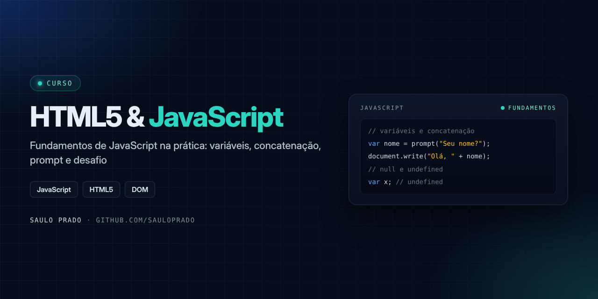

<p align="center">

</p>

<h1 align="center">HTML5 & JavaScript</h1>
<p align="center"><i>Fundamentos de JavaScript na prática, página a página</i></p>

<p align="center">


</p>

## Sumário

- [Sobre](#sobre)
- [O que foi praticado](#o-que-foi-praticado)
- [Como visualizar](#como-visualizar)
- [Estrutura do repositório](#estrutura-do-repositório)
- [Autor](#autor)

## Sobre

Exercícios do curso de **HTML5 e JavaScript**, com foco nos fundamentos da linguagem: cada página HTML demonstra um conceito, e o curso fecha com um desafio prático.

## O que foi praticado

| Arquivo | Conceito |
| --- | --- |
| `variaveis.html` | Declaração e uso de variáveis |
| `concatenacao.html` | Concatenação de textos e valores |
| `prompt.html` | Entrada de dados com `prompt` |
| `null_undefined.html` | Diferença entre `null` e `undefined` |
| `desafio.html` | Desafio final do módulo (resposta em `Desafio/`) |
| `js/scripts.js` | Script externo |

## Como visualizar

Clone o repositório e abra qualquer arquivo `.html` no navegador:

```bash
git clone https://github.com/sauloprado/Html5-Js-20-projetos.git
```

## Estrutura do repositório

```text
Html5-Js-20-projetos/
├── Desafio/resposta_do_desafio.pdf
├── js/scripts.js
├── index.html
├── variaveis.html
├── concatenacao.html
├── prompt.html
├── null_undefined.html
├── desafio.html
└── assets/capa.png
```

## Autor

**Saulo Prado** · Analista de Sistemas · Gestão de Ativos de TI, orçamento, automação e dashboards

[](https://www.linkedin.com/in/saulo-prado-ab4a0b96/)
[](https://github.com/sauloprado)
